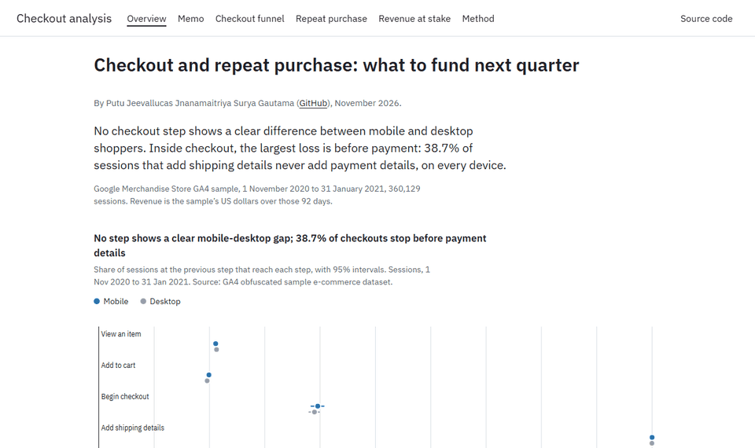
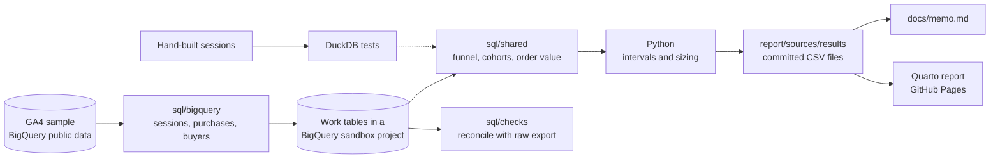
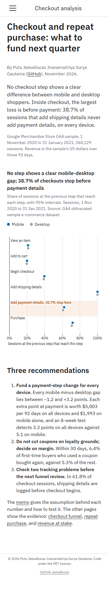
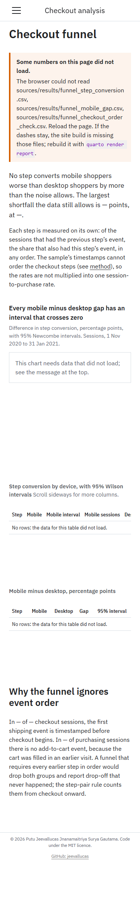

# Checkout and repeat-purchase analysis

An analysis that tells the growth lead of an online merchandise store which checkout step to fund
next quarter, and whether coupon buyers come back as often as other first-time buyers.

By Putu Jeevallucas Jnanamaitriya Surya Gautama ([@jeevallucas](https://github.com/jeevallucas)).

[](https://github.com/jeevallucas/p01-checkout-funnel/actions/workflows/ci.yml)
[](https://jeevallucas.github.io/p01-checkout-funnel/)
[](LICENSE)



Report: <https://jeevallucas.github.io/p01-checkout-funnel/>. Memo: [docs/memo.md](docs/memo.md).

## The problem

The growth lead has engineering time for one checkout change per quarter and a promotion budget
to defend. The usual brief says mobile shoppers drop out of checkout more than desktop shoppers.
In 360,129 sessions of Google's GA4 sample store, no step shows a clear difference: every mobile
minus desktop gap has a 95% interval that crosses zero. The data also misleads a naive analysis:
in 61.8% of checkout sessions the shipping step is logged before checkout begins, and 70.5% of
buyers carry more than one "first-touch" medium.

## What it does

- Measures conversion at six funnel steps by device, with Wilson intervals, and the mobile minus
  desktop gap with Newcombe intervals.
- Follows first-time buyers for 30 and 60 days and compares those who used a coupon with the rest.
- Sizes a payment-step change on all devices against the same change on mobile only, in dollars
  per point and in the lift an A/B test can detect at average and off-peak traffic.
- Writes a two-page memo with three recommendations; every number traces to a committed file.
- Publishes a static report whose numbers are computed from those same files.
- Checks the BigQuery work tables against the raw export, and the shared SQL against hand-built
  sessions in DuckDB.

## How it works



`uv run pipeline all` runs the BigQuery-only queries in `sql/bigquery/`, which unnest GA4's
`event_params` into one row per session step, purchase, and buyer, and store them as tables in the
user's sandbox project. A reconciliation query then checks those tables against counts taken from
the raw export. The queries in `sql/shared/` compute funnel pairs, cohorts, and order value in SQL
that BigQuery and DuckDB share, so the tests run the same text against small hand-built sessions.
Python adds intervals and sizing and writes small CSV files, which the memo quotes and the report
reads.

## Decisions and trade-offs

- **Step pairs that ignore event order, over an ordered funnel.** The sample logs shipping before
  checkout in 61.8% of checkout sessions, and 41.3% of purchasing sessions filled the cart in an
  earlier visit; an ordered funnel reports both as drop-off that never happened. Cost: the six
  step rates cannot be multiplied into one session-to-purchase rate.
- **Sessions over users as the funnel unit.** A checkout change acts within one visit. Cost:
  sessions from the same shopper are treated as independent, which makes intervals slightly too
  narrow, and cart-to-checkout loss is overstated when carts carry across visits.
- **Reading the gap from its interval, not its point estimate.** Mobile converts 1.3 points better
  at payment, but the interval runs from -0.6 to +3.1, so the memo reports no clear difference.
  Wilson and Newcombe intervals were chosen over the normal approximation for the small groups
  (tablet steps, paid-search buyers); at the large mobile and desktop counts they give the same
  answer. Cost: none for the main result; slightly harder to explain.
- **Like-for-like sizing, over a mobile "catch-up" ceiling.** The first draft compared the most
  mobile could gain by catching up with desktop against an assumed all-device lift. The memo now
  sizes the same payment-step lift on all devices and on mobile only. Cost: the headline numbers
  are smaller and less dramatic.
- **Shared SQL tested in DuckDB, over BigQuery-only queries.** CI cannot reach BigQuery without a
  stored key. Cost: the shared queries avoid engine-specific functions, and the BigQuery-only
  flattening is checked by reconciliation against real data instead of by fixtures.
- **Quarto and committed CSV files, over Evidence.** Evidence's template now deprecates its
  open-source build in favour of a hosted service, and the report must be a static page. Cost:
  numbers render in the browser after the CSV files load, so the pages need JavaScript.

Placeholder values: `<Other>` and `(data deleted)` mediums become an "unknown" segment that stays
in the totals; purchase events without a transaction ID count as one order each, and a repeated
ID counts once, on the device of its first event; item-level coupons are always empty, so the
`coupon` event parameter is used; buyers with no first-touch time are left out. The full log is in
[docs/decisions.md](docs/decisions.md), the measured shares in
[docs/data-profile.md](docs/data-profile.md).

## Results

Step conversion, sessions at the previous step that reach this step, 1 November 2020 to
31 January 2021:

| Step | Mobile | Desktop | Mobile minus desktop (95% interval) |
| --- | --- | --- | --- |
| View an item | 21.1% | 21.3% | -0.2 points (-0.4 to +0.1) |
| Add to cart | 19.9% | 19.6% | +0.3 points (-0.3 to +0.9) |
| Begin checkout | 39.6% | 39.0% | +0.6 points (-1.0 to +2.2) |
| Add shipping details | 100.0% | 100.0% | 0.0 points (-0.1 to +0.1) |
| Add payment details | 62.1% | 60.8% | +1.3 points (-0.6 to +3.1) |
| Purchase | 71.7% | 70.7% | +1.0 points (-1.2 to +3.2) |

- Inside checkout, 38.7% of sessions that add shipping details never add payment details, on
  every device. Cart to checkout loses more per session (60.8%), but carts carry across visits.
- Each extra point at payment is worth $5,003 per 92 days on all devices and $1,993 on mobile
  alone, in the sample's dollars. An 8-week test detects a lift of 3.3 points on all devices and
  5.1 on mobile; at January's quieter traffic, 4.1 and 6.4.
- 5.9% of 2,613 first-time buyers bought again within 30 days, and 7.7% of 1,130 within 60 days.
  Coupon buyers repeated at 6.4% against 5.3% without a coupon: +1.1 points, interval -0.7 to +2.9.

How these were measured: `uv run pipeline all` on 2026-11-11 against a BigQuery sandbox project;
a rerun from a fresh clone reproduced every result file byte for byte. The reconciliation matched
5,692 purchase events, 4,419 buyers, and 4,848 purchasing sessions between the raw export and the
work tables. 45 tests pass, including interval values checked against Newcombe (1998) and Cohen
(1988).

## Limitations and next steps

- The data is an obfuscated sample. Dollar figures describe the sample, not the real store, and
  366 first purchases record zero revenue; the ratios and the method are the transferable part.
- The window covers Black Friday and the holidays; the 60-day repeat rate rests on November buyers
  only, and the coupon comparison is observational.
- GA4's user ID identifies a browser, so a shopper on two devices counts twice. The acquisition
  medium is unstable per user, so the medium split is weak.
- Coupon cost and margin are not in the data, so the memo cannot say whether coupons pay.
- Next: a browser-level funnel to size cart-to-checkout loss across visits, a user-clustered
  bootstrap for the intervals, and a survival model for repeat purchase that uses buyers whose
  window the export cuts off.

## Run it locally

Prerequisites: [uv](https://docs.astral.sh/uv/) 0.13 or later (it installs Python 3.13) and
[Quarto](https://quarto.org/docs/get-started/) 1.11 or later.

```bash
git clone https://github.com/jeevallucas/p01-checkout-funnel.git && cd p01-checkout-funnel
uv sync
uv run pytest -q
uv run pipeline sizing
quarto render report
```

Expected: `45 passed`; `pipeline sizing` rewrites the three `sizing_*.csv` files with no change
(`git status` stays clean); Quarto prints `Output created: _site/index.html`, and
`report/_site/index.html` opens the report.

To regenerate every result file from BigQuery you also need the
[Google Cloud CLI](https://cloud.google.com/sdk/docs/install) and a Google Cloud project; the free
BigQuery sandbox is enough. Copy `.env.example` to `.env`, set `GCP_PROJECT_ID`, then run:

```bash
gcloud auth application-default login
uv run pipeline all
```

It processes about 11.5 GB of the sandbox's free 1 TB per month, writes the same files that are
committed, and stops with a message if the reconciliation fails.

## Data and licence

- Source: Google's [GA4 obfuscated sample e-commerce dataset](https://developers.google.com/analytics/bigquery/web-ecommerce-demo-dataset),
  `bigquery-public-data.ga4_obfuscated_sample_ecommerce`, Google Merchandise Store, 2020-11-01 to
  2021-01-31. Google publishes it for exploration and states no licence for the data itself, so
  this repository contains only SQL and aggregated counts and rates, never event rows or user IDs.
- Nothing is synthetic except the hand-built sessions in the tests.
- Code: MIT, see [LICENSE](LICENSE).

## Design notes

The report is memo-first: a single column for a growth lead who reads it on a laptop before a
planning meeting, with one chart, the step ladder, carrying the main finding. Blue means mobile,
green coupon buyers, vermillion the step worth funding, grey everything else, and every chart has
a table with the same numbers. axe reports no violations at 375, 768, and 1440 px, and Lighthouse
on the live site scores 96 to 98 for performance and 100 for accessibility on every page. The brief,
review rounds, and Lighthouse scores are in [docs/design-brief.md](docs/design-brief.md) and
[docs/design-review.md](docs/design-review.md).

| Phone, 375 px | Data files blocked |
| --- | --- |
|  |  |
