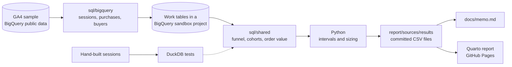

# Checkout and repeat-purchase analysis

An analysis that tells the growth lead of an online merchandise store which checkout step to fund
next quarter, and whether coupon-led acquisition brings buyers who come back.

[](https://github.com/jeevallucas/p01-checkout-funnel/actions/workflows/ci.yml)
[](https://jeevallucas.github.io/p01-checkout-funnel/)
[](LICENSE)


Report: <https://jeevallucas.github.io/p01-checkout-funnel/> (static, no wake-up wait).
Memo: [docs/memo.md](docs/memo.md).

## The problem

The growth lead has engineering time for one checkout change per quarter and a promotion budget
to defend. The usual brief says mobile shoppers drop out of checkout more than desktop shoppers.
In 360,129 sessions of Google's GA4 sample store, they do not: at every step the mobile minus
desktop gap has a 95% interval that crosses zero. The data also misleads a naive analysis. In
61.8% of checkout sessions the shipping step is logged before checkout begins, and 70.5% of buyers
carry more than one "first-touch" medium.

## What it does

- Measures conversion at six checkout steps by device, with Wilson intervals, and the mobile minus
  desktop gap with Newcombe intervals, so noise is not reported as a finding.
- Follows first-time buyers for 30 and 60 days and compares those who used a coupon with the rest.
- Sizes revenue at stake two ways: the best case for a mobile-only fix, and each point of
  payment-step conversion for all devices.
- Sizes the A/B test or holdout behind each recommendation, so "test it" has a length and a
  detectable effect.
- Writes a two-page memo with three recommendations; every number traces to a committed file.
- Publishes a static report whose numbers are computed from those same files.

## How it works



`uv run pipeline all` runs the BigQuery-only queries in `sql/bigquery/`, which unnest GA4's
`event_params` into one row per session step, purchase, and buyer, and store them as tables in the
user's sandbox project. The queries in `sql/shared/` then compute funnel pairs, cohorts, and order
value; they use only SQL that BigQuery and DuckDB share, so the tests run the same text against
small hand-built sessions. Python adds intervals and sizing and writes small CSV files. The memo
quotes those files, and the Quarto report reads them in the browser.

## Decisions and trade-offs

- **Step pairs that ignore event order, over an ordered funnel.** The sample logs shipping before
  checkout in 61.8% of checkout sessions, and 41.3% of purchasing sessions filled the cart in an
  earlier visit; an ordered funnel reports both as drop-off that never happened. Cost: the six
  step rates cannot be multiplied into one session-to-purchase rate.
- **Sessions over users as the funnel unit.** A checkout change is tested and felt within one
  visit. Cost: sessions from the same shopper are treated as independent, which makes the
  intervals slightly too narrow.
- **Wilson and Newcombe intervals over the textbook normal interval.** Tablet steps and repeat
  purchases have small counts, where the normal interval undercovers. The intervals are what turn
  "mobile converts 1.3 points better at payment" into "no clear difference". Cost: harder to
  explain than plus or minus two standard errors.
- **Shared SQL tested in DuckDB, over BigQuery-only queries.** CI cannot reach BigQuery without a
  stored key. Cost: the shared queries avoid engine-specific functions, and dates travel as day
  numbers.
- **Quarto and committed CSV files, over Evidence.** Evidence's template now deprecates its
  open-source build in favour of a hosted service, and the report must be a static page. Cost:
  numbers render in the browser, which shifts the layout once on three pages.
- **30 and 60-day repeat windows, over 90 days.** The export spans 92 days, so a 90-day window
  would rest on two days of buyers. Cost: the 60-day rate covers November buyers only.

How placeholder values were handled: `<Other>` and `(data deleted)` mediums become an "unknown"
segment that stays in the totals; purchase events without a transaction ID count as one order
each, and repeated IDs count once; item-level coupons are always empty, so the `coupon` event
parameter is used instead; buyers with no first-touch time are left out. The rest of the log is in
[docs/decisions.md](docs/decisions.md); the measured placeholder shares are in
[docs/data-profile.md](docs/data-profile.md).

## Results

Step conversion, sessions at the previous step that reach this step, 1 November 2020 to
31 January 2021:

| Step | Mobile | Desktop | Mobile minus desktop (95% interval) |
| --- | --- | --- | --- |
| View an item | 21.1% | 21.3% | -0.2 points (-0.4 to +0.1) |
| Add to cart | 19.9% | 19.6% | +0.3 points (-0.3 to +0.9) |
| Begin checkout | 39.6% | 39.0% | +0.6 points (-1.0 to +2.2) |
| Add shipping details | 100.0% | 100.0% | 0.0 points (-0.1 to +0.1) |
| Add payment details | 62.1% | 60.8% | +1.3 points (-0.6 to +3.1) |
| Purchase | 71.7% | 70.7% | +1.0 points (-1.2 to +3.2) |

- The payment step loses 38.7% of the sessions that reach it, on every device. Each extra point
  there is worth $5,003 per 92 days in the sample's dollars. A mobile-only fix could add at most
  $1,200, assuming the mobile deficit is as large as its interval allows and a fix closes half.
- 5.9% of 2,613 first-time buyers bought again within 30 days, and 7.7% of 1,130 within 60 days.
  Coupon buyers repeated at 6.4% against 5.3% without a coupon: +1.1 points, interval -0.7 to +2.9.
- Recommendation to test first: an 8-week 50/50 test of a payment-step change on all devices.
  With 3,379 sessions per arm it detects a lift of 3.3 points or more (61.3% to 64.6%).

How these were measured: `uv run pipeline all` on 2026-11-11 ran 19 queries and processed 10.39 GB
in a BigQuery sandbox project. A rerun from a fresh clone reproduced every result file byte for
byte. 40 tests pass, including interval values checked against Newcombe (1998) and Cohen (1988).

## Limitations and next steps

- The data is an obfuscated sample. Dollar figures describe the sample, not the real store; the
  ratios and the method are the transferable part.
- The window covers Black Friday and the holidays, and the 60-day repeat rate rests on November
  buyers only.
- The acquisition medium is unstable per user in this sample, so the medium split is weak; the
  coupon split is the stronger one.
- Coupon cost and margin are not in the data, so the memo can say coupon buyers are not worse
  repeaters but cannot say whether coupons pay for themselves.
- Intervals treat sessions as independent. A next step is a user-clustered bootstrap, and a
  survival model for repeat purchase that uses buyers whose window is cut off by the export's end.
- The report computes its prose numbers in the browser, which shifts the layout once (CLS about
  0.2) on three pages. Computing them at build time would remove it.

## Run it locally

Prerequisites: [uv](https://docs.astral.sh/uv/) 0.13 or later (it installs Python 3.13) and
[Quarto](https://quarto.org/docs/get-started/) 1.11 or later.

```bash
git clone https://github.com/jeevallucas/p01-checkout-funnel.git && cd p01-checkout-funnel
uv sync
uv run pytest -q
uv run pipeline sizing
quarto render report
```

Expected: `40 passed`; `pipeline sizing` rewrites the three `sizing_*.csv` files with no change
(`git status` stays clean); Quarto prints `Output created: _site/index.html`, and
`report/_site/index.html` opens the report.

To regenerate every result file from BigQuery, you also need the
[Google Cloud CLI](https://cloud.google.com/sdk/docs/install) and a Google Cloud project; the free
BigQuery sandbox is enough. Copy `.env.example` to `.env`, set `GCP_PROJECT_ID`, then run:

```bash
gcloud auth application-default login
uv run pipeline all
```

It processes about 10.4 GB of the sandbox's free 1 TB per month and writes the same files that are
committed.

## Data and licence

- Source: Google's [GA4 obfuscated sample e-commerce dataset](https://developers.google.com/analytics/bigquery/web-ecommerce-demo-dataset),
  `bigquery-public-data.ga4_obfuscated_sample_ecommerce`, Google Merchandise Store, 2020-11-01 to
  2021-01-31. Google publishes it for exploration and states no licence for the data itself, so
  this repository contains only SQL and aggregated counts and rates, never event rows or user IDs.
- Nothing is synthetic except the hand-built sessions in the tests.
- Code: MIT, see [LICENSE](LICENSE).

## Design notes

- **Users and context.** A growth lead and two teammates read the report on laptops before a
  planning meeting; someone reopens a chart on a phone during it. The full brief is in
  [docs/design-brief.md](docs/design-brief.md).
- **Type.** IBM Plex Sans for prose, its condensed width for chart labels and tables, so seven
  steps and their labels fit a 375 px screen. Inter, the usual default, was rejected because it has
  no condensed width.
- **Colour.** Grey for context, blue only for mobile, green only for coupon buyers, vermillion only
  for the step worth funding. The first grey and green failed a colour-blind check against each
  other and were replaced; links are ink, not blue, because blue means mobile.
- **Layout.** A memo-first single column instead of a dashboard grid, because the reader has two
  decisions to make, not metrics to monitor. The one bold element is the step ladder, where the
  mobile and desktop dots sit on top of each other.
- **Accessibility.** axe reports no violations at 375, 768, and 1440 px; every chart has a table
  with the same numbers; colour is never the only signal. The review rounds and Lighthouse scores
  are in [docs/design-review.md](docs/design-review.md).

| Phone, 375 px | Data files blocked |
| --- | --- |
|  |  |
